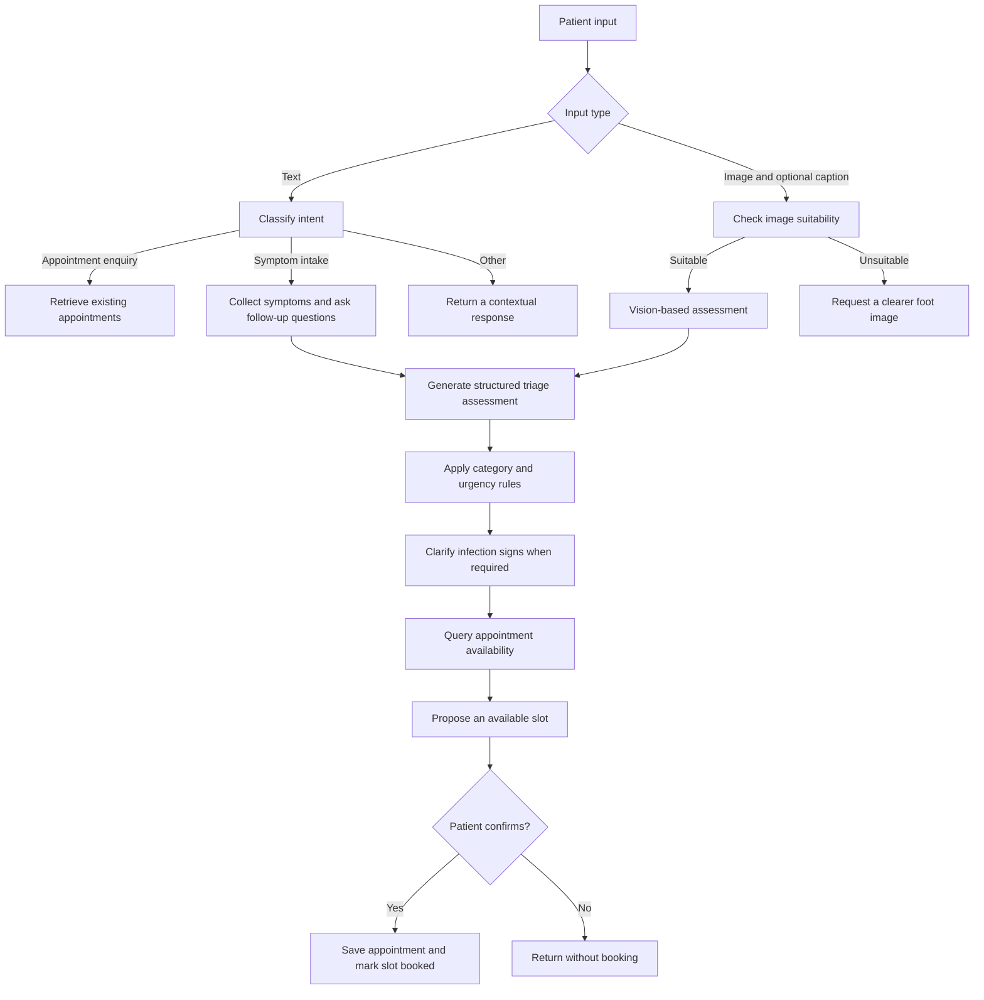

# AI Podiatry Assistant

**A multimodal AI agent for conversational symptom intake, triage, and appointment coordination, with a companion assistant for podiatrists.**

The application connects AI conversations to an operational workflow: a patient describes a concern or uploads a photo, the agent gathers context, produces a structured triage assessment, queries available appointments, and completes a booking after confirmation. Podiatrists can review the resulting case summaries, query their schedules, and manage appointments through a dedicated dashboard and conversational interface.

Built with **JavaScript, Node.js, Express, OpenAI, and Firebase**, with **Twilio** for SMS notifications.

> This is an academic prototype. AI-generated assessments and urgency labels demonstrate the application workflow and require clinical validation before use in patient care.

## AI agent capabilities

### Patient agent: from conversation to booking

| Capability | Implementation |
| --- | --- |
| Intent detection | Classifies messages into appointment enquiries, symptom/triage requests, or other conversation. |
| Multi-turn intake | Maintains conversation state and asks follow-up questions before generating a text-based triage assessment. |
| Multimodal assessment | Accepts a foot image and optional caption; checks image suitability before invoking the vision assessment. |
| Structured triage output | Extracts a category, initial assessment, urgency level, and clinician-facing summary from model output. |
| Rule-based post-processing | Applies symptom and risk-factor rules to adjust model-generated categories and urgency. |
| Appointment coordination | Queries Firestore availability within urgency-dependent date windows and accounts for existing appointments. |
| Confirmed booking | Asks the patient to accept a proposed slot before creating the appointment and marking availability as booked. |
| Accessible interaction | Supports English, Chinese, Malay, and Tamil, plus speech-to-text input where supported by the browser. |

The prototype routes cases through four categories: **wound care**, **nail surgery**, **high-risk footcare**, and **musculoskeletal (MSK)**. Its urgency rules are application logic, rather than a validated clinical scoring system.

### How the patient agent works



The orchestration is implemented directly in Express routes using an explicit conversation state machine. The language model handles intent recognition, follow-up questions, assessment generation, and summaries; application code handles state transitions, database queries, rule checks, and booking writes.

Key states include `idle`, `triage`, `confirm_infection_check`, and `awaiting_confirmation`. Each patient session stores symptom messages, assessment results, and the proposed appointment slot.

The current implementation calls OpenAI Chat Completions directly. Text workflows use `gpt-3.5-turbo`; the image suitability check and vision assessment use `gpt-4o-mini`. Model identifiers are defined in the route files.

**Start with:** [patientRoutes.js](functions/patientRoutes.js) and [patient.js](public/js/patient.js).

### Podiatrist assistant: context-aware case review

The clinician interface combines conversational requests with application actions:

- **Schedule enquiries:** retrieves appointments for a requested date and supplies the retrieved schedule to the model for an overview.
- **Case review:** retrieves a selected appointment and patient details to contextualize the generated analysis; cancelled appointments return their status instead of a new analysis.
- **Urgent-case and summary views:** offers quick actions for urgent cases and upcoming case summaries.
- **Appointment editing:** detects edit/reschedule requests and opens an appointment-selection workflow before applying changes.
- **General assistance:** answers clinician queries through a separate OpenAI-backed chat endpoint.

Schedule and edit requests are routed using application-side pattern matching. Database records provide context for relevant responses; general chat responses do not use a curated retrieval knowledge base.

**Start with:** [podiatrist_aichat.js](public/js/podiatrist_aichat.js) and [podiatristRoutes.js](functions/podiatristRoutes.js).

## Supporting application features

- Separate patient and podiatrist interfaces, with Firebase Authentication and role-specific profile records.
- Appointment history, scheduling views, dashboard metrics, and clinician notifications.
- Firebase Storage uploads for images associated with patient assessments.
- Twilio SMS integration for appointment updates, cancellations, phone verification, and reminders.
- A scheduled reminder function configured for **09:00 Asia/Singapore** to process the following day's appointments.
- Translation caching for multilingual interaction.
- A separate keyword-based FAQ support widget for login and account help.
- A GitHub Actions workflow configured to deploy Firebase Hosting and Functions on pushes to `main`.

## Architecture

```mermaid
flowchart LR
    UI[Patient and podiatrist web interfaces] --> AUTH[Firebase Authentication]
    UI --> HOST[Firebase Hosting]
    HOST --> API[Express API on Firebase Cloud Functions]
    API --> LLM[OpenAI text and vision models]
    API --> DB[(Cloud Firestore)]
    API --> STORAGE[Firebase Storage]
    API --> SMS[Twilio SMS and Verify]
    CLOCK[Scheduled reminder function] --> DB
    CLOCK --> SMS
