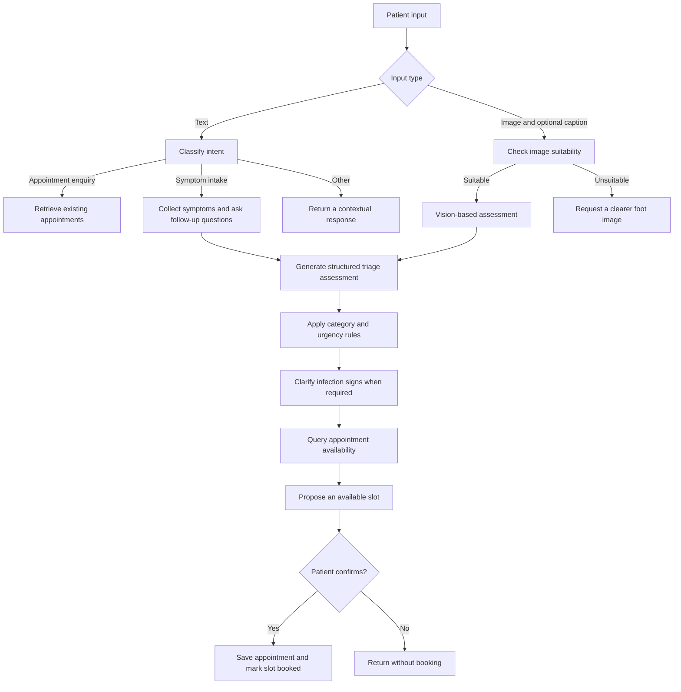
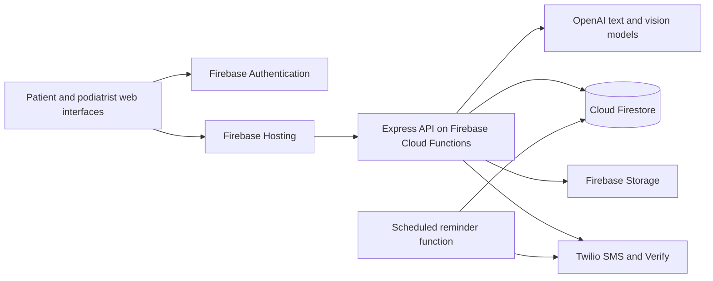

# AI Podiatry Assistant

**A multimodal AI agent for conversational symptom intake, triage, and appointment coordination, with a companion assistant for podiatrists.**

The application connects AI conversations to an operational workflow: a patient describes a concern or uploads a photo, the agent gathers context, produces a structured triage assessment, queries available appointments, and completes a booking after confirmation. Podiatrists can review the resulting case summaries, query their schedules, and manage appointments through a dedicated dashboard and conversational interface.

Built with **JavaScript, Node.js, Express, OpenAI, and Firebase**, with **Twilio** for SMS notifications.

> This is an academic prototype. AI-generated assessments and urgency labels demonstrate the application workflow and require clinical validation before use in patient care.

## AI agent capabilities

### Patient agent: from conversation to booking

| Capability | Implementation |
| --- | --- |
| Intent detection | Classifies messages into appointment enquiries, symptom/triage requests, or other conversation. |
| Multi-turn intake | Maintains conversation state and asks follow-up questions before generating a text-based triage assessment. |
| Multimodal assessment | Accepts a foot image and optional caption; checks image suitability before invoking the vision assessment. |
| Structured triage output | Extracts a category, initial assessment, urgency level, and clinician-facing summary from model output. |
| Rule-based post-processing | Applies symptom and risk-factor rules to adjust model-generated categories and urgency. |
| Appointment coordination | Queries Firestore availability within urgency-dependent date windows and accounts for existing appointments. |
| Confirmed booking | Asks the patient to accept a proposed slot before creating the appointment and marking availability as booked. |
| Accessible interaction | Supports English, Chinese, Malay, and Tamil, plus speech-to-text input where supported by the browser. |

The prototype routes cases through four categories: **wound care**, **nail surgery**, **high-risk footcare**, and **musculoskeletal (MSK)**. Its urgency rules are application logic, rather than a validated clinical scoring system.

### How the patient agent works



The orchestration is implemented directly in Express routes using an explicit conversation state machine. The language model handles intent recognition, follow-up questions, assessment generation, and summaries; application code handles state transitions, database queries, rule checks, and booking writes.

Key states include `idle`, `triage`, `confirm_infection_check`, and `awaiting_confirmation`. Each patient session stores symptom messages, assessment results, and the proposed appointment slot.

The current implementation calls OpenAI Chat Completions directly. Text workflows use `gpt-3.5-turbo`; the image suitability check and vision assessment use `gpt-4o-mini`. Model identifiers are defined in the route files.

**Start with:** [patientRoutes.js](functions/patientRoutes.js) and [patient.js](public/js/patient.js).

### Podiatrist assistant: context-aware case review

The clinician interface combines conversational requests with application actions:

- **Schedule enquiries:** retrieves appointments for a requested date and supplies the retrieved schedule to the model for an overview.
- **Case review:** retrieves a selected appointment and patient details to contextualize the generated analysis; cancelled appointments return their status instead of a new analysis.
- **Urgent-case and summary views:** offers quick actions for urgent cases and upcoming case summaries.
- **Appointment editing:** detects edit/reschedule requests and opens an appointment-selection workflow before applying changes.
- **General assistance:** answers clinician queries through a separate OpenAI-backed chat endpoint.

Schedule and edit requests are routed using application-side pattern matching. Database records provide context for relevant responses; general chat responses do not use a curated retrieval knowledge base.

**Start with:** [podiatrist_aichat.js](public/js/podiatrist_aichat.js) and [podiatristRoutes.js](functions/podiatristRoutes.js).

## Supporting application features

- Separate patient and podiatrist interfaces, with Firebase Authentication and role-specific profile records.
- Appointment history, scheduling views, dashboard metrics, and clinician notifications.
- Firebase Storage uploads for images associated with patient assessments.
- Twilio SMS integration for appointment updates, cancellations, phone verification, and reminders.
- A scheduled reminder function configured for **09:00 Asia/Singapore** to process the following day's appointments.
- Translation caching for multilingual interaction.
- A separate keyword-based FAQ support widget for login and account help.
- A GitHub Actions workflow configured to deploy Firebase Hosting and Functions on pushes to `main`.

## Architecture



Firebase Hosting serves the frontend and rewrites `/patient/**`, `/api/**`, and `/sms/**` to the `api` Cloud Function. Functions are configured for `asia-southeast1`, using Node.js 22.

| Layer | Technologies |
| --- | --- |
| Frontend | HTML, CSS, JavaScript, browser SpeechRecognition |
| Backend | Node.js 22, Express, Firebase Cloud Functions v2 |
| AI | OpenAI SDK, text and vision Chat Completions |
| Persistence | Cloud Firestore, Firebase Storage |
| Authentication | Firebase Authentication |
| Messaging | Twilio SMS and Verify |
| Translation | `translate-google`, in-memory cache |
| Delivery | Firebase Hosting, GitHub Actions |

## Repository guide

```text
public/
  patient.html                    Patient interface
  podiatrist.html                 Clinician interface
  login.html / register.html      Authentication screens
  js/
    patient.js                    Patient chat, uploads, translation, voice input
    podiatrist_aichat.js           Clinician chat and appointment-edit workflows
    config/firebase-config.js     Browser Firebase configuration
    utils/                        Browser session and page-access helpers
functions/
  index.js                        Cloud Function entry point and route mounting
  patientRoutes.js                Patient agent and image triage orchestration
  podiatristRoutes.js             Clinician assistant and appointment APIs
  firebase.js                     Firebase Admin and Storage initialization
  smsService.js / smsRoutes.js     Messaging and verification integration
  seedAvailability.js             Availability data helper
firebase.json                     Hosting rewrites and Functions configuration
.github/workflows/                Firebase deployment workflow
```

The deployed backend entry point is `functions/index.js`. The root `server.js` is a legacy server file with imports that do not match the current layout; use the Firebase Functions workflow below.

## Setup

### Prerequisites

- Node.js **22** and npm.
- Firebase CLI and a Firebase development project with Authentication, Firestore, and Storage enabled.
- An OpenAI API key with access to the configured models.
- Twilio credentials for exercising SMS and verification features.

### 1. Install dependencies

```bash
git clone https://github.com/brendantnn/ai-podiatry-assistant.git
cd ai-podiatry-assistant
npm install
npm install --prefix functions
npm install -g firebase-tools
```

`functions/patientRoutes.js` imports Busboy, which is currently declared only in the root package. Add it to the Functions package before deploying an independently packaged backend:

```bash
npm install --prefix functions busboy@^1.6.0
```

### 2. Configure your Firebase project

```bash
firebase login
firebase use --add
```

Select your own development project and update:

- `public/js/config/firebase-config.js` with its web app configuration.
- `functions/firebase.js` with its Storage bucket name.
- `.firebaserc` with the selected project alias.
- The deployment workflow's project ID and credentials if enabling automated deployment.

Enable email/password authentication. Configure Firestore access rules and any composite indexes required by the queries; rules and index definitions are not included in this repository.

### 3. Configure local secrets and credentials

Create `functions/.secret.local` for emulator-only secret overrides:

```dotenv
OPENAI_API_KEY=your_openai_api_key
TWILIO_ACCOUNT_SID=your_twilio_account_sid
TWILIO_AUTH_TOKEN=your_twilio_auth_token
TWILIO_PHONE_NUMBER=your_twilio_phone_number
TWILIO_VERIFY_SERVICE_SID=your_twilio_verify_service_sid
```

Add `functions/.secret.local` to `.gitignore` before saving credentials. For Firebase Admin access to development cloud services, configure Application Default Credentials; see [Firebase's local Functions guide](https://firebase.google.com/docs/functions/local-emulator). The [Firebase configuration guide](https://firebase.google.com/docs/functions/config-env#secrets_and_credentials_in_the_cloud_functions_emulator) documents local secret overrides.

### 4. Prepare demo data

Register synthetic patient and podiatrist accounts through the application. Registration creates role-specific profiles and identifiers such as `patient_1` and `pod_1`.

Add future appointment slots to the `Availability` collection:

| Field | Type | Example |
| --- | --- | --- |
| `podId` | String | `pod_1` |
| `availableDate` | Firestore Timestamp | A future appointment date and time |
| `status` | String | `available` |

The included `functions/seedAvailability.js` helper uses a fixed end date of **2025-12-31** and a local service-account file. Update its date range, podiatrist ID, and credential handling before using it for a new demo.

### 5. Run locally

From the repository root:

```bash
firebase emulators:start --only hosting,functions
```

Open the Hosting URL printed by the CLI and navigate to `/login.html`.

This starts local Hosting and Functions. Authentication, Firestore, and Storage still use the configured cloud project: the browser's Auth/Firestore emulator connections are commented out, and a complete local data-emulator configuration is not included. Use a dedicated development project and synthetic data.

### Deployment configuration

`functions/index.js` binds the OpenAI and Twilio credentials using `defineSecret`. Configure the five corresponding secrets with `firebase functions:secrets:set SECRET_NAME` in your selected project before deployment. The existing GitHub Actions workflow expects a `FIREBASE_TOKEN` repository secret and targets the original project; adapt it before enabling deployment for another project.

## Suggested demo walkthrough

1. Sign in as a demo patient and submit a synthetic foot concern.
2. Answer the agent's follow-up questions and inspect the assessment and proposed appointment.
3. Confirm the slot and verify that the appointment appears in Firestore with its summary and urgency fields.
4. Start a fresh session and upload a synthetic or appropriately licensed foot image to demonstrate image gating and the vision workflow.
5. Sign in as a demo podiatrist, ask for today's schedule, and review a selected case.
6. Open the appointment-edit workflow and demonstrate a reschedule using demo records.

## Current limitations and next steps

- **Session persistence:** patient conversation state is held in process memory; it does not persist across restarts or synchronize between Function instances.
- **Booking consistency:** appointment creation and slot updates are separate writes. Transactional booking and idempotency are needed to handle concurrent requests reliably.
- **Access and image privacy:** browser role checks are present, but the shown agent routes do not verify Firebase ID tokens or enforce record ownership. Image uploads currently call `makePublic()`. Server-side authorization and private image access are necessary before handling real patient data.
- **Assessment reliability:** model responses are parsed from formatted text. Structured schemas, broader error handling, and a reproducible evaluation dataset would strengthen the workflow. No clinical accuracy benchmark is reported here.
- **Demo integrations:** Singpass screens simulate a login flow; they do not establish a production Singpass integration. Speech recognition depends on browser support.
